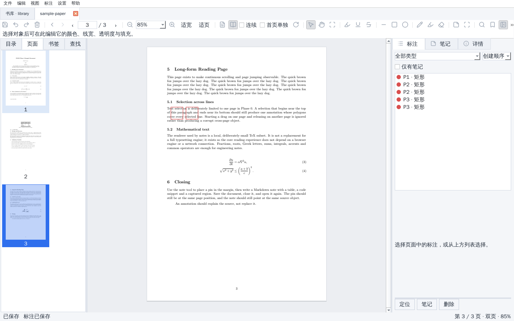
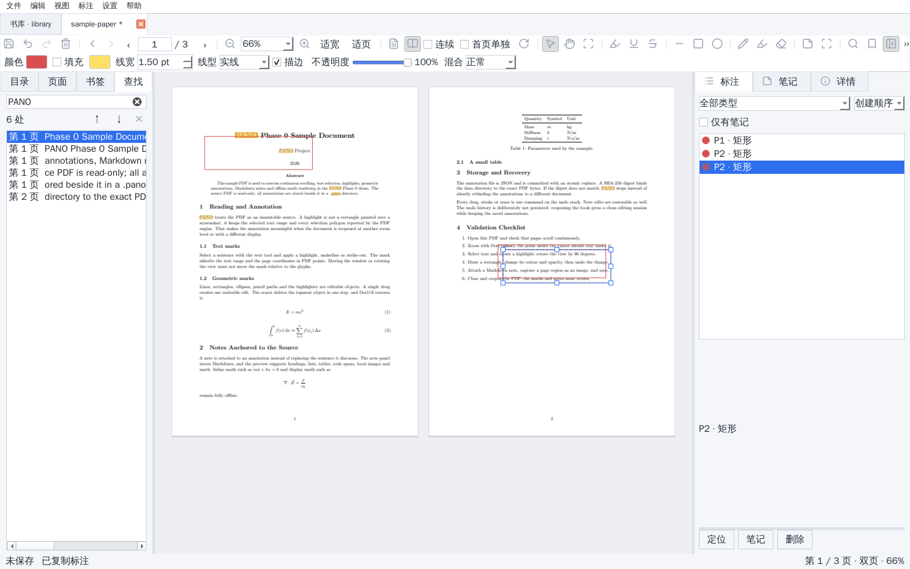
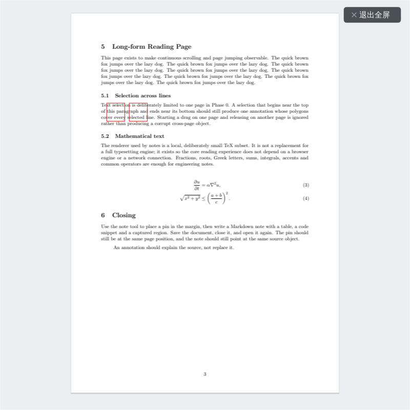

# PANO

PANO 是一款本地优先的 PDF 阅读与标注工作区。它把 PDF 视为只读源文件，在独立的书库
目录中保存标注、阅读状态和 Markdown 笔记；不依赖账号、云端或网络。

当前版本是 Phase 2.1 阅读器交互与界面精修版本。在 Phase 2 的布局、搜索、书签、历史
和全屏基础上，重排了阅读器界面：顶部两级工具栏、左侧目录/缩略图/书签/查找、右侧
标注/笔记/详情、底部状态区；并修复全屏退出、连续橡皮、非连续滚轮翻页、页码控件、
历史出发点和滚动范围。Phase 0 的 Demo 已归档到 [`demo/`](demo/)，根工程不再依赖
Demo 代码。








## 功能

- 书库：创建/打开/切换书库，拷贝或映射导入 PDF，SHA-256 内容识别，重复导入提示，
  封面生成。
- 组织：多级书架、收藏、回收站软删除/恢复/永久删除、搜索与排序。
- 阅读：单页、连续单页、双页、连续双页四种布局；固定比例/适合宽度/适合页面缩放；
  0/90/180/270 旋转；首页单独、页间距、滚轮翻页；滚动时按可见面积选择当前页。
- 导航：统一导航入口；目录、缩略图、搜索、标注、书签和页码跳转共用页内定位；Alt+←/→
  前进/后退；全屏 F11；阅读锚点随窗口/侧栏变化保持。
- 标注：文字高亮/下划线/删除线，直线、矩形、椭圆、铅笔、荧光笔、对象橡皮；文字选区按
  行合并，减少词间空隙；直线/矩形/椭圆支持五种线型和描边开关。
- 智能选择：选择工具单击文字进入文本选择，拖动空白框选区域；Ctrl 强制框选，Alt 强制
  文本选择。文本和区域选区显示贴近选区的浮动操作条；支持文字/区域右键菜单。
- 搜索与书签：Ctrl+F 全文搜索，结果列表按页显示并可前后跳转，临时高亮不写入标注；
  Ctrl+B 添加书签，书签独立保存、重命名、排序和删除。
- 阅读界面：顶部主工具栏（阅读导航/缩放/布局/工具/辅助）+ 当前工具/对象属性栏；
  左侧目录/缩略图/书签/查找，右侧标注/笔记/详情；底部仅状态区。工具和属性可直接编辑。
- 阅读交互：页码输入 + 上一页/下一页；非连续布局滚轮翻页、组语义和反向定位；全屏
  F11/右上角退出；导航历史记录真实出发点；大文档打开计时探针。
- 笔记与标注操作：标注附带 Markdown 笔记、图片、区域截图和本地公式渲染；笔记 2 秒
  空闲自动保存。选择对象可复制/粘贴/复制一份，使用自定义 MIME 保留完整样式。
- 工具预设：每个工具独立保存颜色、线宽、线型、描边、填充、透明度和混合模式；新建
  标注不受其他工具或旧标注影响。设置窗口修改按工具暂存，应用/确定才写入。
- 书库：三栏浏览、封面/列表切换、面包屑、直接子书架书籍、拖拽加入书架/收藏/回收站。
- 工作区：书库标签页 + 可关闭的阅读标签页；每个标签独立保存阅读状态、阅读锚点和撤销
  历史。
- 橡皮：按住拖动连续擦除对象，半径 4–25 px 可调，一次拖动一步撤销，带笔记对象需确认。
- 可靠性：`QSaveFile` 原子写入、书库单实例锁、外部修改检测、源 PDF 哈希校验；永久删除
  使用隔离目录和恢复标记，失败可回滚。
- 外观：四套主题（现代浅色、经典、暖色、现代深色），界面字体与标注默认样式可调。

主题示例：

| 暖色 | 现代深色 |
| --- | --- |
|  |  |

## 环境

- C++20 编译器（在 Arch Linux / GCC 16 上验证）
- Qt 6.6 或更新的 Qt Widgets、Qt PDF、Qt SVG（图标着色）
- xmake 3.x
- Linux 或 Windows 桌面环境；当前只在 Linux 上实际构建和运行

本项目使用 Qt 6 SDK 的 `QtWidgets` 与 `QtPdf`。系统 Qt 的 PDF 版本不一致时，请显式
指定 Qt SDK 前缀。

## 构建

```bash
xmake f -c -m debug --qt=/path/to/Qt/6.x.y/gcc_64
xmake -j4
```

`--qt` 必须指向包含 `QtWidgets`、`QtPdf` 的 Qt 6 SDK 前缀；如果系统 Qt 的 PDF
部件版本不一致，自动探测可能选错 SDK，因此建议显式传入。

可执行文件位于 `build/linux/x86_64/debug/pano-reader`（Linux）。发布构建把
`-m debug` 换成 `-m release`。

## 运行

```bash
./build/linux/x86_64/debug/pano-reader
./build/linux/x86_64/debug/pano-reader /path/to/library
```

首次启动进入欢迎页，可新建书库或打开已有书库。也可以直接把 PDF 拖到窗口或书库页
导入。

示例 PDF：`examples/sample-paper.pdf`（源文件 `examples/sample-paper.tex`）。

## 书库目录

```text
<library>/
  library.json
  books/<book>/
    document.json
    annotations.json
    bookmarks.json
    source.pdf       # 仅拷贝模式
    cover.png
    assets/
  bookshelf/shelves.json
  state/reading.json
  state/history.json
  .pending-delete/    # 永久删除隔离与恢复标记
  .pano.lock
```

本机配置（主题、上次书库、打开标签、映射源覆盖）放在 Qt 配置目录，不写入书库。
完整字段与语义见 [`docs/specification/phase1-data-formats.md`](docs/specification/phase1-data-formats.md)（Phase 2/2.1 增补了布局、缩放模式、书签字段、滚轮翻页和阅读器面板宽度）。

原则：

- 源 PDF 只读；标注和笔记永远在书库目录中。
- 拷贝模式把 PDF 副本放进书库；映射模式只保存引用，可用本机 `sources.json` 重定位。
- 源文件哈希不一致、书库锁冲突、外部 JSON 修改都会拒绝写入并提示，不静默覆盖。
- 旧 Demo 的 `.pano` 数据不会自动迁移。

## 构建检查与探针

```bash
xmake -j4                                  # 全部目标
./build/linux/x86_64/debug/pano-library-probe
./build/linux/x86_64/debug/pano-phase1-probe examples/sample-paper.pdf build/probe/phase1-ui.png
./build/linux/x86_64/debug/pano-coordinate-probe
./build/linux/x86_64/debug/pano-text-geometry-probe
./build/linux/x86_64/debug/pano-interaction-probe
./build/linux/x86_64/debug/pano-phase2-probe
./build/linux/x86_64/debug/pano-open-timing "/path/to/book.pdf"
./build/linux/x86_64/debug/pano-pdf-timing examples/sample-paper.pdf
PANO_CONFIG_DIR=/tmp/pano-config QT_QPA_PLATFORM=offscreen \
  ./build/linux/x86_64/debug/pano-theme-probe
```

探针覆盖数据安全、导入与哈希、书架不变量、标注/笔记持久化、外部修改保护、阅读状态、
四种旋转与滚动坐标变换、文字选区合并、智能选择与浮动操作、主题与设置取消、四种页面
布局、缩放模式、搜索/书签/导航、复制粘贴、橡皮连续擦除、阅读器交互与全屏退出；不替代
人工 GUI 验收。结果记录在
[`docs/development/log/phase2.1-results.md`](docs/development/log/phase2.1-results.md)，
Phase 2 见 [`phase2-results.md`](docs/development/log/phase2-results.md)，Phase 1.2 见
[`phase1.2-results.md`](docs/development/log/phase1.2-results.md)。

## 目录

| 路径 | 内容 |
| --- | --- |
| `src/app/` | `MainWindow`、`LibraryView`、`ReaderWorkspace`、`NotePanel` 等界面 |
| `src/library/` | 书库、书籍、书架、导入与源文件解析 |
| `src/document/` | 书籍文档会话、自动保存、阅读状态 |
| `src/pdf/` | Qt PDF 文档封装与异步页面渲染缓存 |
| `src/reader/` | 分页布局与 PDF 视图 |
| `src/annotation/` | 标注数据、模型、命令、绘制与命中 |
| `src/note/` | Markdown/公式渲染、笔记预览 |
| `src/storage/` | JSON 原子写入、书库存储 |
| `src/settings/` | 本机配置、主题、设置窗口 |
| `docs/specification/` | 数据格式规范 |
| `docs/development/` | 阶段需求、结果记录、截图 |
| `demo/` | Phase 0 归档工程，独立构建 |
| `tools/` | 数据/坐标/主题/UI 探针与示例 PDF 构建脚本 |

## 已知限制

- 只在 Linux 上验证；Windows/高 DPI 未实际构建验收。
- 搜索只针对 PDF 文本层；扫描 PDF 无可搜索文本。文字选择限制在单页；不支持 OCR 或
  PDF 导出；双栏论文跨栏选区仍建议人工复核。
- P01 大 PDF 打开性能只做了文档加载/首屏测量（864 页扫描件：load 5 ms、几何 97 ms、
  首屏 45 ms，本机 Qt PDF），未做完整 1–2 秒停顿的 GUI 剖析。
- 全屏只保留阅读画布，退出依赖 F11/Esc；工具栏/菜单在部分主题下仍有细节样式可打磨。
- 多文档切换、缩略图快速切换、真实拖拽手势和大书库回归仍需人工验收。
- 本阶段不包含云同步、账号、移动端或多人协作。

## 许可

MIT，见 [`LICENSE`](LICENSE)。
