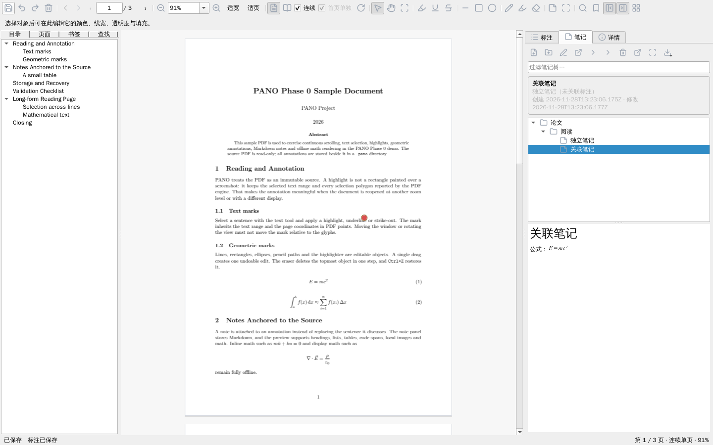
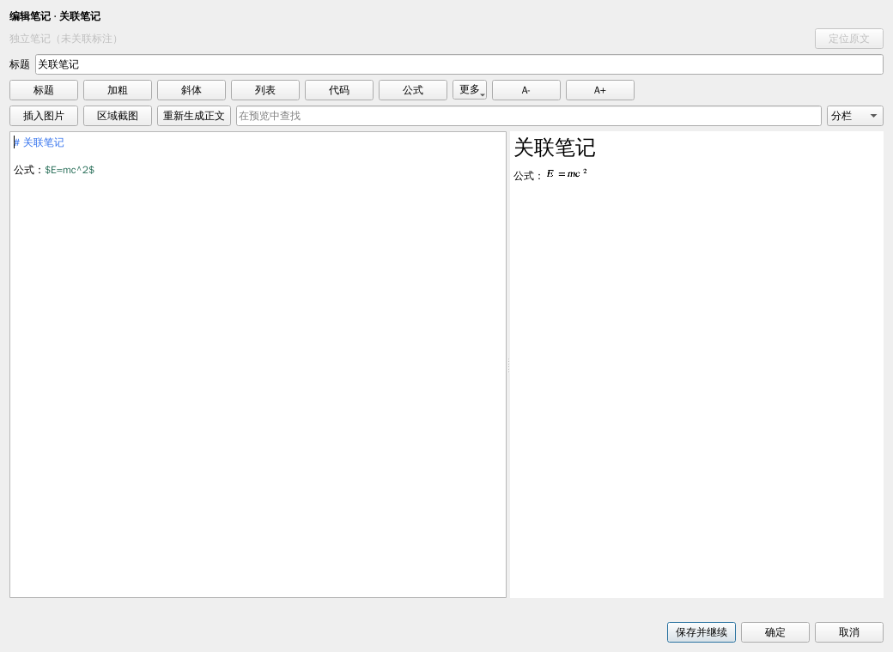
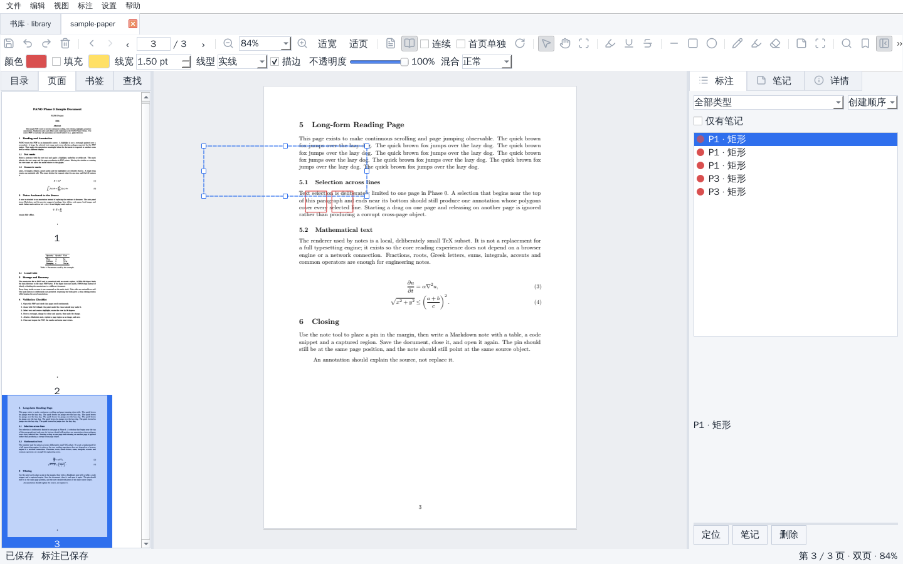
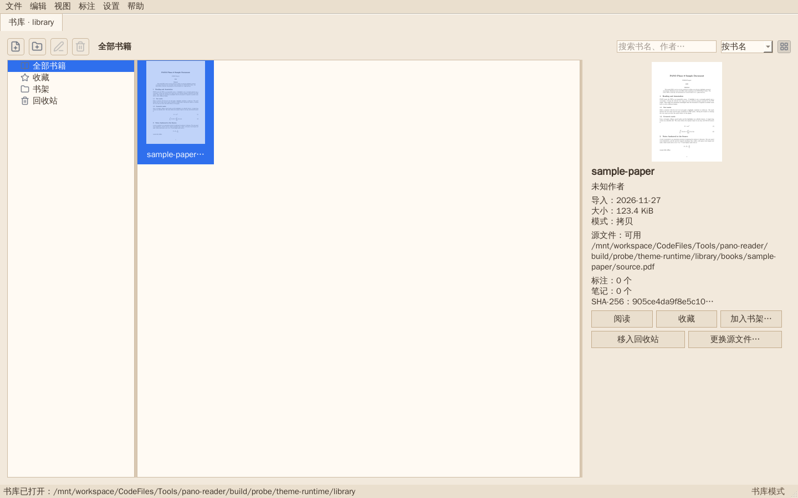
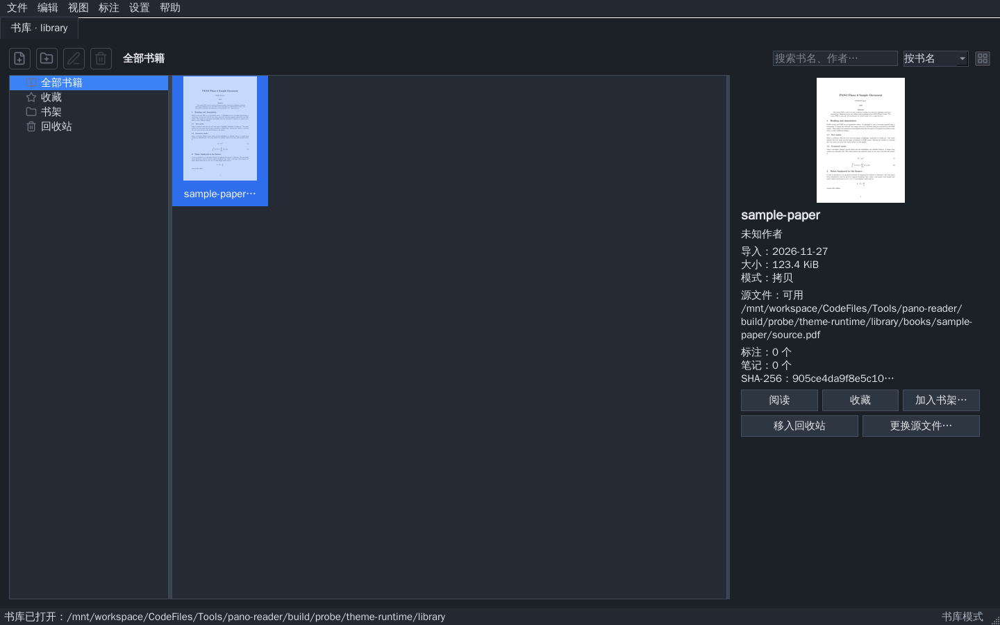

# PANO

PANO 是一款本地优先的 PDF 阅读与标注工作区。它把 PDF 视为只读源文件，在独立的书库
目录中保存标注、阅读状态和 Markdown 笔记；不依赖账号、云端或网络。

当前版本是 Phase 3.2.1 笔记数据安全与稳定化版本。正式程序采用模块化静态库构建；
笔记编辑器使用 MD4C + JKQTMathText 渲染 Markdown/公式，提供两栏预览、格式工具栏、
查找、字号持久化和笔记/树导出；阅读器继续使用独立 `Note` 模型、`NoteTree` 和
`annotations.json` schema 2。旧 schema 1 数据会被明确拒绝，不做自动迁移。

本阶段重点修复草稿生命周期与数据安全：编辑器草稿不再被自动保存、切换标签或主窗口
保存隐式提交；只有显式保存或关闭时选择的“保存”才以一次原子写入发布 Note、关联、
笔记树和必要标注。取消定位笔记不会留下 NotePoint、树节点或撤销项；未提交图片按草稿
归属清理。资源路径、导出目标、同名分组、虚拟根节点和双向关联也已收紧。
Phase 0 的 PDF Demo 和 Phase 3.0 Markdown Demo 归档在 [`demo/`](demo/)，由根工程
选项按需构建，默认不参与正式构建。







## 功能

- 书库：创建/打开/切换书库，拷贝或映射导入 PDF，SHA-256 内容识别，重复导入提示，
  封面生成。
- 组织：多级书架、收藏、回收站软删除/恢复/永久删除、搜索与排序。
- 阅读：单页、连续单页、双页、连续双页四种布局；固定比例/适合宽度/适合页面缩放；
  0/90/180/270 旋转；首页单独、页间距、滚轮翻页；滚动时按可见面积选择当前页。
- 导航：统一导航入口；目录、缩略图、搜索、标注、书签和页码跳转共用页内定位；Alt+←/→
  前进/后退；全屏 F11；阅读锚点随窗口/侧栏变化保持。
- 标注：文字高亮/下划线/删除线，直线、矩形、椭圆、铅笔、荧光笔、对象橡皮；文字选区按
  行合并，减少词间空隙；直线/矩形/椭圆支持五种线型和描边开关。
- 智能选择：选择工具单击文字进入文本选择，拖动空白框选区域；Ctrl 强制框选，Alt 强制
  文本选择。文本和区域选区显示贴近选区的浮动操作条；支持文字/区域右键菜单。
- 搜索与书签：Ctrl+F 全文搜索，结果列表按页显示并可前后跳转，临时高亮不写入标注；
  Ctrl+B 添加书签，书签独立保存、重命名、排序和删除。
- 阅读界面：顶部主工具栏（阅读导航/缩放/布局/工具/辅助）+ 当前工具/对象属性栏；
  左侧目录/缩略图/书签/查找，右侧标注/笔记/详情；底部仅状态区。工具和属性可直接编辑。
- 阅读交互：页码输入 + 上一页/下一页；非连续布局滚轮翻页、组语义和反向定位；页按钮
  与 PageUp/PageDown 语义分离；全屏 F11/右上角退出；统一 Esc 分层；导航历史记录真实
  出发点；大文档打开计时探针。
- 阅读稳定性：属性栏固定单行高度；缩略图按可见范围异步加载、缓存命中直接显示、失败
  有限重试；不透明度修改防抖提交；全屏查找先恢复全屏外查找面板。
- 独立笔记与笔记树：笔记拥有稳定的独立 ID、标题和 Markdown 正文；可放在书库根分组
  或多级笔记树中，也可与一个标注建立可选的一对一关联。右侧笔记页提供新建笔记/分组、
  重命名、移动、排序、删除、关联/解除关联和精确定位；独立非模态编辑器绑定
  `book_id + note_id`，支持保存继续、确定关闭、取消和关闭前保存提示。
- 数据安全：笔记草稿在保存成功前不写入正式文件，取消或丢弃不会留下半成品对象；
  外部修改 `annotations.json` 时拒绝覆盖并保留草稿；导出拒绝覆盖、符号链接和书库内部
  目标；Markdown 图片仅允许书库内普通文件并限制大小。
- 笔记内容：使用 MD4C（CommonMark/GFM）和 JKQTMathText 离线渲染 Markdown、表格、
  删除线、行内/显示公式、矩阵与分段函数；图片和区域截图保存在书库 `assets/`。编辑器
  支持格式工具栏、预览查找、字号持久化、保存继续/确定/取消，草稿在保存成功前不写入
  书库。笔记树支持按标题/正文过滤，并可将当前笔记导出为 Markdown、按树层级导出全部
  笔记或导出 JSON；导出时会复制相对图片资源。
- 工具预设：每个工具独立保存颜色、线宽、线型、描边、填充、透明度和混合模式；新建
  标注不受其他工具或旧标注影响。设置窗口修改按工具暂存，应用/确定才写入。
- 书库：三栏浏览、封面/列表切换、面包屑、直接子书架书籍、拖拽加入书架/收藏/回收站。
- 工作区：书库标签页 + 可关闭的阅读标签页；每个标签独立保存阅读状态、阅读锚点和撤销
  历史。
- 橡皮：按住拖动连续擦除对象，半径 4–25 px 可调，一次拖动一步撤销；关联笔记的标注
  默认跳过，需通过标注列表或右键菜单显式处理笔记。
- 可靠性：`QSaveFile` 原子写入、书库单实例锁、外部修改检测、源 PDF 哈希校验；永久删除
  使用隔离目录和恢复标记，失败可回滚。
- 外观：四套主题（现代浅色、经典、暖色、现代深色），界面字体与标注默认样式可调。

主题示例：

| 暖色 | 现代深色 |
| --- | --- |
|  |  |

## 环境

- C++20 编译器（Arch Linux / GCC 16 上长期验证；Windows 上使用 MSVC）
- Qt 6.6 或更新的 Qt Widgets、Qt PDF、Qt SVG（图标着色）、Qt Xml（JKQTCommon 依赖）
- xmake 3.x
- MD4C 0.6 与 JKQTMathText（正式程序笔记预览依赖；见
  [`docs/THIRD_PARTY_NOTICES.md`](docs/THIRD_PARTY_NOTICES.md)）
- Linux 或 Windows 桌面环境；Linux 上 MD4C/JKQT 来自发行版包，Windows 上 MD4C 由
  xmake 包管理器下载，JKQT 需要用仓库脚本以 MSVC 构建一次

本项目使用 Qt 6 SDK 的 `QtWidgets` 与 `QtPdf`。系统 Qt 的 PDF 版本不一致时，请显式
指定 Qt SDK 前缀。

## 构建

根目录 `xmake.lua` 是仓库唯一正式构建入口。默认只构建正式程序及其内部静态库，
不探测或链接测试、诊断与 Demo 依赖：

```bash
xmake f -c -m debug --qt=/path/to/Qt/6.x.y/gcc_64 \
  --build_tests=n --build_tools=n --build_demo=n --build_markdown_demo=n
xmake -j4
```

默认只构建 `pano-reader` 及其内部静态库；测试探针、性能诊断和两个 Demo 都需要显式开启。
正式程序现在需要 MD4C 和 JKQTMathText。默认在 `build/deps/jkqt/usr` 查找 JKQT；
也可用 `JKQT_ROOT=/path/to/jkqt/usr` 指定。首次准备可运行：

```bash
demo/markdown/tools/fetch-deps.sh
```

该脚本只准备本地依赖，不参与默认构建；缺少依赖时构建会明确失败。

Windows 上没有对应的发行版包，JKQT 需要用 MSVC 构建一次。仓库脚本会下载固定版本的
JKQtPlotter，只编译项目需要的 `JKQTCommon` 与 `JKQTMathText` 静态库，并安装到
`build\deps\jkqt\usr`：

```powershell
powershell -ExecutionPolicy Bypass -File scripts\fetch-jkqt-windows.ps1
```

脚本从 `.xmake\windows\x64\xmake.conf` 读取 `--qt` 配置（也可用 `-QtDir` 显式指定），
`-Force` 强制重新下载与构建。两个库名在 Linux 与 Windows 上一致（都带 `_RelWithDebInfo`
后缀），因此 xmake 目标共用同一套链接名。MD4C 在 Windows 由 xmake 包管理器自动下载
安装（根 `xmake.lua` 的 `add_requires("md4c")`），不需要手工准备。

`--qt` 必须指向包含 `QtWidgets`、`QtPdf` 的 Qt 6 SDK 前缀；如果系统 Qt 的 PDF
部件版本不一致，自动探测可能选错 SDK，因此建议显式传入。

可执行文件位于 `build/linux/x86_64/debug/pano-reader`（Linux）。发布构建把
`-m debug` 换成 `-m release`。

Windows 上的配置与构建（PowerShell，先执行过上面的 JKQT 脚本）：

```powershell
xmake f -c -p windows -a x64 -m release --qt=C:\Qt\6.x.y\msvc2022_64 `
  --build_tests=n --build_tools=n --build_demo=n --build_markdown_demo=n
xmake -j4
```

可执行文件位于 `build\windows\x64\release\pano-reader.exe`。

### 可选测试、诊断与 Demo

四个独立选项默认均为 `n`；只有显式启用时才包含对应局部 xmake targets。切换选项后
建议先执行 `xmake f -c`，避免旧配置和目标缓存残留。

```bash
# 功能回归探针
xmake f -c -m debug --qt=/path/to/Qt/6.x.y/gcc_64 --build_tests=y --build_tools=n
xmake -j4
# 探针源文件位于 tests/

# 性能诊断
xmake f -c -m debug --qt=/path/to/Qt/6.x.y/gcc_64 --build_tests=n --build_tools=y
xmake -j4
```

```bash
# Phase 0 PDF Demo（targets 以 pano-demo- 开头）
xmake f -c -m debug --qt=/path/to/Qt/6.x.y/gcc_64 --build_demo=y --build_markdown_demo=n
xmake build -j4 pano-demo-reader

# Phase 3.0 Markdown Demo（需先准备 MD4C / JKQTMathText）
xmake f -c -m debug --qt=/path/to/Qt/6.x.y/gcc_64 --build_demo=n --build_markdown_demo=y
xmake build -j4 pano-markdown-demo
```

Markdown Demo 依赖准备与详细说明见 [`demo/markdown/README.md`](demo/markdown/README.md)。
关闭 Demo 时重新配置两个选项为 `n` 即可；正式目标名称（`pano-reader`、内部 `pano-*` 库）保持不变；
探针名称仅在 `--build_tests=y` 时出现。

## 运行

```bash
./build/linux/x86_64/debug/pano-reader
./build/linux/x86_64/debug/pano-reader /path/to/library
```

首次启动进入欢迎页，可新建书库或打开已有书库。也可以直接把 PDF 拖到窗口或书库页
导入。

示例 PDF：`examples/sample-paper.pdf`（源文件 `examples/sample-paper.tex`）。

## 书库目录

```text
<library>/
  library.json
  books/<book>/
    document.json
    annotations.json
    bookmarks.json
    source.pdf       # 仅拷贝模式
    cover.png
    assets/
  bookshelf/shelves.json
  state/reading.json
  state/history.json
  .pending-delete/    # 永久删除隔离与恢复标记
  .pano.lock
```

本机配置（主题、上次书库、打开标签、映射源覆盖）放在 Qt 配置目录，不写入书库。
完整字段与语义见 [`docs/specification/phase1-data-formats.md`](docs/specification/phase1-data-formats.md)。
Phase 3.1 起 `annotations.json` 使用 `schema_version: 2`，同时保存 `annotations`、
`notes` 和 `note_tree`；旧 schema 1 会被拒绝读取并保持原文件不变。

原则：

- 源 PDF 只读；标注和笔记永远在书库目录中。
- 拷贝模式把 PDF 副本放进书库；映射模式只保存引用，可用本机 `sources.json` 重定位。
- 源文件哈希不一致、书库锁冲突、外部 JSON 修改都会拒绝写入并提示，不静默覆盖。
- 旧 Demo 的 `.pano` 数据不会自动迁移。

## 构建检查与探针

```bash
xmake -j4                                  # 全部目标
# 先使用 --build_tests=y 配置并构建
./build/linux/x86_64/debug/pano-library-probe
./build/linux/x86_64/debug/pano-phase1-probe examples/sample-paper.pdf build/probe/phase1-ui.png
./build/linux/x86_64/debug/pano-coordinate-probe
./build/linux/x86_64/debug/pano-text-geometry-probe
./build/linux/x86_64/debug/pano-interaction-probe
./build/linux/x86_64/debug/pano-phase2-probe
./build/linux/x86_64/debug/pano-note-probe examples/sample-paper.pdf
./build/linux/x86_64/debug/pano-open-timing "/path/to/book.pdf"
./build/linux/x86_64/debug/pano-pdf-timing examples/sample-paper.pdf
PANO_CONFIG_DIR=/tmp/pano-config QT_QPA_PLATFORM=offscreen \
  ./build/linux/x86_64/debug/pano-theme-probe
```

探针覆盖数据安全、导入与哈希、书架不变量、标注/笔记持久化、外部修改保护、阅读状态、
四种旋转与滚动坐标变换、文字选区合并、智能选择与浮动操作、主题与设置取消、四种页面
布局、缩放模式、搜索/书签/导航、复制粘贴、橡皮连续擦除、滚轮翻页冷却、Shift 两点路径、
属性栏高度、缩略图缓存与全屏退出；不替代人工 GUI 验收。Phase 3.2.1 见
[`phase3.2.1-results.md`](docs/development/log/phase3.2.1-results.md)，Phase 3.2 见
[`phase3.2-results.md`](docs/development/log/phase3.2-results.md)，Phase 3.1 见
[`phase3.1-results.md`](docs/development/log/phase3.1-results.md)，Phase 2.2 见
[`phase2.2-results.md`](docs/development/log/phase2.2-results.md)，Phase 2.1 见
[`phase2.1-results.md`](docs/development/log/phase2.1-results.md)，Phase 2
见 [`phase2-results.md`](docs/development/log/phase2-results.md)，Phase 1.2 见
[`phase1.2-results.md`](docs/development/log/phase1.2-results.md)。

## 目录

| 路径 | 内容 |
| --- | --- |
| `src/app/` | `MainWindow`、`LibraryView`、`ReaderWorkspace`、`NoteEditDialog`、图标与界面组件 |
| `src/library/` | 书库、书籍、书架、导入与源文件解析 |
| `src/document/` | 书籍文档会话、笔记/标注事务、自动保存、阅读状态、书签 |
| `src/pdf/` | Qt PDF 文档封装与异步页面渲染缓存 |
| `src/reader/` | 分页布局与 PDF 视图 |
| `src/annotation/` | 标注数据、模型、命令、绘制与命中 |
| `src/note/` | 独立笔记模型、笔记树、Markdown/公式渲染与预览 |
| `src/storage/` | JSON 原子写入、书库存储 |
| `src/settings/` | 本机配置、主题、设置窗口 |
| `docs/specification/` | 数据格式规范 |
| `docs/development/` | 阶段需求、结果记录、截图 |
| `demo/` | Phase 0 归档工程，独立构建 |
| `tests/` | 八项确定性功能探针（`--build_tests=y`） |
| `tools/` | 打开/渲染性能诊断（`--build_tools=y`）与示例 PDF 构建脚本 |
| `src/buildcfg/` | 按模块拆分的 xmake 目标定义 |

## 已知限制

- 只在 Linux 上验证；Windows/高 DPI 未实际构建验收。
- 搜索只针对 PDF 文本层；扫描 PDF 无可搜索文本。文字选择限制在单页；不支持 OCR 或
  PDF 导出；双栏论文跨栏选区仍建议人工复核。
- P01 大 PDF 打开性能只做了文档加载/首屏测量（864 页扫描件：load 5 ms、几何 97 ms、
  首屏 45 ms，本机 Qt PDF）；应用打开路径仍同步计算全文件 SHA-256，约 1 秒，异步化
  留待后续阶段。
- 全屏只保留阅读画布和右上角退出按钮，F11/Esc 可用；工具栏/菜单在部分主题下仍有细节
  样式可打磨。
- 多文档切换、缩略图快速切换、真实拖拽手势和大书库回归仍需人工验收。
- 本阶段不包含云同步、账号、移动端或多人协作。

## 许可

MIT，见 [`LICENSE`](LICENSE)。
