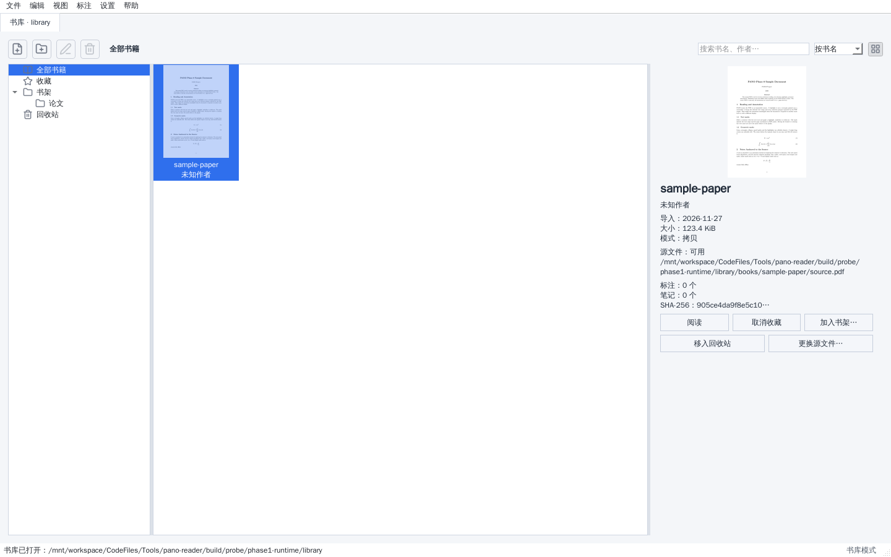
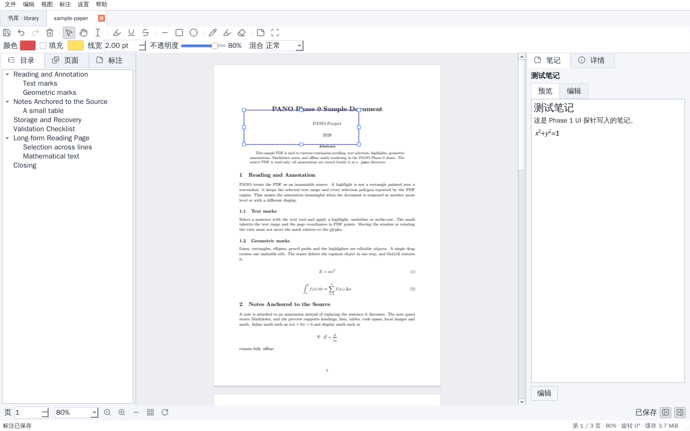

# PANO

PANO 是一款本地优先的 PDF 阅读与标注工作区。它把 PDF 视为只读源文件，在独立的书库
目录中保存标注、阅读状态和 Markdown 笔记；不依赖账号、云端或网络。

当前版本是 Phase 1.1 界面与交互稳定化版本，包含书库管理、多标签阅读、图标工具栏、
标注/笔记、工具预设、主题和本机配置。Phase 0 的 Demo 已归档到 [`demo/`](demo/)，根
工程不再依赖 Demo 代码。





## 功能

- 书库：创建/打开/切换书库，拷贝或映射导入 PDF，SHA-256 内容识别，重复导入提示，
  封面生成。
- 组织：多级书架、收藏、回收站软删除/恢复/永久删除、搜索与排序。
- 阅读：连续分页、页码跳转、固定比例/适合宽度/适合页面缩放、0/90/180/270 旋转。
- 标注：文字高亮/下划线/删除线，直线、矩形、椭圆、铅笔、荧光笔、对象橡皮；文字选区按
  行合并，减少词间空隙。
- 阅读界面：两行图标工具栏（主工具 + 当前工具/对象属性）、目录/页面缩略图/标注左侧栏、
  笔记/详情右侧栏；工具和属性可直接编辑。
- 笔记：标注附带的 Markdown 笔记，支持图片、区域截图、行内/独立公式的本地渲染；编辑
  时 2 秒空闲自动保存，30 秒最长等待。
- 工具预设：每个工具独立保存颜色、线宽、透明度、混合模式；新建标注不受其他工具或
  旧标注影响。
- 书库：三栏浏览、封面/列表切换、面包屑、直接子书架书籍、拖拽加入书架/收藏/回收站。
- 工作区：书库标签页 + 可关闭的阅读标签页；每个标签独立保存阅读状态、阅读锚点和撤销
  历史。
- 可靠性：`QSaveFile` 原子写入、书库单实例锁、外部修改检测、源 PDF 哈希校验。
- 外观：四套主题（现代浅色、经典、暖色、现代深色），界面字体与标注默认样式可调。

主题示例：

| 暖色 | 现代深色 |
| --- | --- |
|  |  |

## 环境

- C++20 编译器（在 Arch Linux / GCC 16 上验证）
- Qt 6.6 或更新的 Qt Widgets、Qt PDF、Qt SVG（图标着色）
- xmake 3.x
- Linux 或 Windows 桌面环境；当前只在 Linux 上实际构建和运行

本项目使用 Qt 6 SDK 的 `QtWidgets` 与 `QtPdf`。系统 Qt 的 PDF 版本不一致时，请显式
指定 Qt SDK 前缀。

## 构建

```bash
xmake f -c -m debug --qt=/path/to/Qt/6.x.y/gcc_64
xmake -j4
```

`--qt` 必须指向包含 `QtWidgets`、`QtPdf` 的 Qt 6 SDK 前缀；如果系统 Qt 的 PDF
部件版本不一致，自动探测可能选错 SDK，因此建议显式传入。

可执行文件位于 `build/linux/x86_64/debug/pano-reader`（Linux）。发布构建把
`-m debug` 换成 `-m release`。

## 运行

```bash
./build/linux/x86_64/debug/pano-reader
./build/linux/x86_64/debug/pano-reader /path/to/library
```

首次启动进入欢迎页，可新建书库或打开已有书库。也可以直接把 PDF 拖到窗口或书库页
导入。

示例 PDF：`examples/sample-paper.pdf`（源文件 `examples/sample-paper.tex`）。

## 书库目录

```text
<library>/
  library.json
  books/<book>/
    document.json
    annotations.json
    source.pdf       # 仅拷贝模式
    cover.png
    assets/
  bookshelf/shelves.json
  state/reading.json
  state/history.json
  .pano.lock
```

本机配置（主题、上次书库、打开标签、映射源覆盖）放在 Qt 配置目录，不写入书库。
完整字段与语义见 [`docs/specification/phase1-data-formats.md`](docs/specification/phase1-data-formats.md)。

原则：

- 源 PDF 只读；标注和笔记永远在书库目录中。
- 拷贝模式把 PDF 副本放进书库；映射模式只保存引用，可用本机 `sources.json` 重定位。
- 源文件哈希不一致、书库锁冲突、外部 JSON 修改都会拒绝写入并提示，不静默覆盖。
- 旧 Demo 的 `.pano` 数据不会自动迁移。

## 构建检查与探针

```bash
xmake -j4                                  # 全部目标
./build/linux/x86_64/debug/pano-library-probe
./build/linux/x86_64/debug/pano-phase1-probe examples/sample-paper.pdf build/probe/phase1-ui.png
./build/linux/x86_64/debug/pano-coordinate-probe
./build/linux/x86_64/debug/pano-text-geometry-probe
PANO_CONFIG_DIR=/tmp/pano-config QT_QPA_PLATFORM=offscreen \
  ./build/linux/x86_64/debug/pano-theme-probe
```

探针覆盖数据安全、导入与哈希、书架不变量、标注/笔记持久化、外部修改保护、阅读状态、
四种旋转与滚动坐标变换、文字选区合并、主题切换；不替代人工 GUI 验收。结果记录在
[`docs/development/log/phase1.1-results.md`](docs/development/log/phase1.1-results.md)，
Phase 1 基线见 [`phase1-results.md`](docs/development/log/phase1-results.md)。

## 目录

| 路径 | 内容 |
| --- | --- |
| `src/app/` | `MainWindow`、`LibraryView`、`ReaderWorkspace`、`NotePanel` 等界面 |
| `src/library/` | 书库、书籍、书架、导入与源文件解析 |
| `src/document/` | 书籍文档会话、自动保存、阅读状态 |
| `src/pdf/` | Qt PDF 文档封装与异步页面渲染缓存 |
| `src/reader/` | 分页布局与 PDF 视图 |
| `src/annotation/` | 标注数据、模型、命令、绘制与命中 |
| `src/note/` | Markdown/公式渲染、笔记预览 |
| `src/storage/` | JSON 原子写入、书库存储 |
| `src/settings/` | 本机配置、主题、设置窗口 |
| `docs/specification/` | 数据格式规范 |
| `docs/development/` | 阶段需求、结果记录、截图 |
| `demo/` | Phase 0 归档工程，独立构建 |
| `tools/` | 数据/坐标/主题/UI 探针与示例 PDF 构建脚本 |

## 已知限制

- 只在 Linux 上验证；Windows 未实际构建。
- 高 DPI、超大 PDF、真实鼠标的复杂标注/旋转操作仍需人工验收；本轮已检查
  1440×900 下的书库/阅读/主题截图。
- 文字选择限制在单页；扫描 PDF 没有 OCR；不支持 PDF 导出；双栏英文论文的跨栏选区
  仍建议人工复核。
- 公式渲染覆盖常用子集，不支持的 TeX 命令会以源码或占位显示。
- 橡皮为点击式删除，尚未实现连续擦除。
- 多级书架、拖拽、缩略图和设置取消/应用已实现并做过程序化检查，但复杂交互仍建议人工
  走查。
- 本阶段不包含云同步、账号、移动端或多人协作。

## 许可

MIT，见 [`LICENSE`](LICENSE)。
