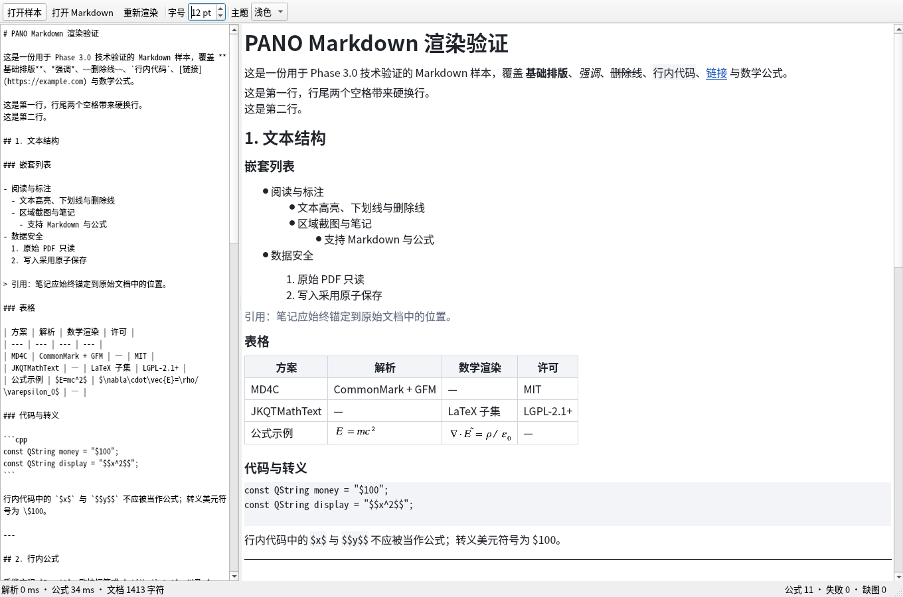
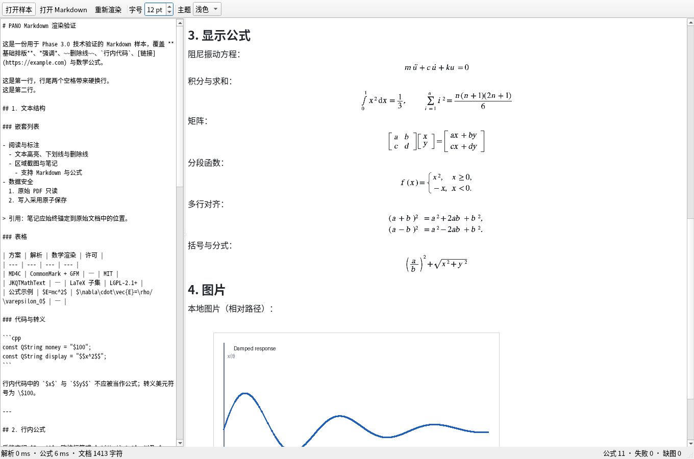
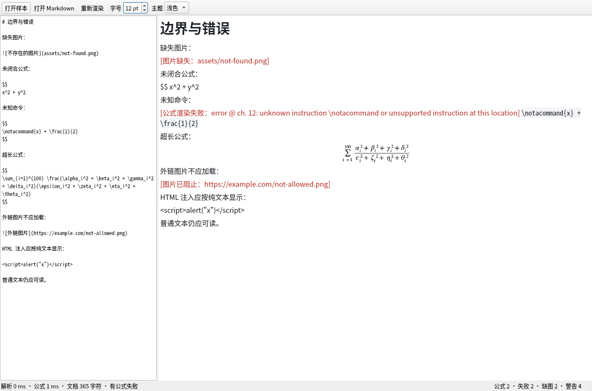

# PANO Markdown + 数学公式渲染技术验证

这是 PANO Phase 3.0 的**独立技术演示**，用于验证 Markdown 渲染和数学公式在 Qt Widgets 中的可行性。它不属于正式阅读器功能，也不改变根工程的构建、数据格式或产品代码。

演示只读取本地 Markdown 样本，不访问网络、不读写书库、不加载用户 PDF。

## 技术路线

```
Markdown (UTF-8)
  → MD4C（CommonMark + GFM 表格/删除线 + LaTeX 数学 span）
  → 普通 HTML + <x-equation> 数学占位
  → JKQTMathText 渲染为透明 QImage
  → QTextDocument / QTextBrowser（图片资源内嵌）
```

- Markdown 解析：MD4C 0.6.x，MIT。
- 数学渲染：JKQTMathText（JKQTPlotter 包中的数学子库），LGPL-2.1-or-later，动态链接。
- 界面：Qt 6 Widgets，C++20，xmake。
- 数学图片以 `QTextDocument::ImageResource` 注入，不写临时文件、不使用 WebEngine。

## 依赖

| 依赖 | 验证版本 | 说明 |
| --- | --- | --- |
| Qt | 6.12.0（SDK `/home/yue/Qt/6.12.0/gcc_64`） | Widgets；系统另有 6.12.1 |
| MD4C | 0.6.0-2 | `md4c` / `md4c-html` |
| JKQTPlotter | 5.0.0git20251013-2 (Arch) | 仅链接 `JKQTMathText`、`JKQTCommon` 动态库 |
| xmake | 3.1.2 | 根工程统一入口 |
| g++ | 16.2.1 | C++20 |

JKQT 包是用系统 Qt 6.12.1 构建的，本次演示实际加载 SDK Qt 6.12.0；Qt 6.12.x 间 ABI 兼容已实测可运行，但正式集成仍应保持构建与运行 Qt 小版本一致。

## 目录

```
demo/markdown/
├── xmake.lua                 # 根工程 include 的局部 target 定义
├── tools/fetch-deps.sh       # 下载并解压 JKQTMathText（Arch 包）
├── src/
│   ├── main.cpp
│   ├── MarkdownDemoWindow.*  # 编辑/预览/主题/字号/截图 CLI
│   └── MarkdownMathRenderer.*# MD4C + JKQTMathText 渲染管线
├── examples/
│   ├── sample.md             # 成功样例
│   ├── edge-cases.md         # 缺图/未闭合公式/未知命令/外链/HTML 注入
│   └── assets/response.png   # 本地相对路径图片
└── docs/                     # 验证截图
```

## 构建

Phase 3.1 起，仓库根目录 `xmake.lua` 是唯一构建入口。Demo 不再是独立项目，也不再使用
`xmake -P .`；它由根工程选项按需包含。

```bash
# 在仓库根目录
./demo/markdown/tools/fetch-deps.sh
xmake f -c -m debug --qt=/home/yue/Qt/6.12.0/gcc_64 \
  --build_demo=n --build_markdown_demo=y
xmake build -j4 pano-markdown-demo
```

脚本默认把依赖解压到仓库根 `build/deps/jkqt/usr`。非 Arch 系统可通过 `JKQT_PKG_URL`
指定可解压的 JKQTPlotter 包；脚本只处理 `jkqtmathtext` 所需文件，不做系统安装。
如已有 JKQT 前缀，可跳过脚本并设置 `JKQT_ROOT`（目录应包含
`include/jkqtmathtext/` 和 `lib/libJKQTMathText6_RelWithDebInfo.so`）：

```bash
JKQT_ROOT=/path/to/jkqt/usr xmake f -c -m debug --qt=/path/to/Qt/6.x.y/gcc_64 \
  --build_demo=n --build_markdown_demo=y
xmake build -j4 pano-markdown-demo
```

切换 Demo 选项后建议使用 `xmake f -c` 重新配置，避免旧 target 缓存残留。关闭时：

```bash
xmake f -c -m debug --qt=/path/to/Qt/6.x.y/gcc_64 \
  --build_demo=n --build_markdown_demo=n
```

可执行文件：

```bash
./build/linux/x86_64/debug/pano-markdown-demo
```

## 运行与 CLI

```bash
# 默认打开 examples/sample.md
./build/linux/x86_64/debug/pano-markdown-demo

# 打开任意 Markdown
./build/linux/x86_64/debug/pano-markdown-demo --file examples/edge-cases.md

# 深色主题、预览字号
./build/linux/x86_64/debug/pano-markdown-demo --dark --font 18

# 离屏截图（验证用），可选 --width/--scroll
QT_QPA_PLATFORM=offscreen ./build/linux/x86_64/debug/pano-markdown-demo \
  --screenshot build/shot.png
```

界面：左侧 Markdown 编辑区，右侧渲染预览；工具栏提供打开样本、打开 Markdown、重新渲染（F5）、字号 9–26 pt、浅色/深色主题。编辑后 300 ms 自动重渲染；预览宽度变化会重新渲染，使显示公式按可用宽度缩放。

## 渲染策略

- **Markdown**：MD4C 的 `MD_DIALECT_GITHUB`（表格、删除线）+ `MD_FLAG_LATEXMATHSPANS` + `MD_FLAG_NOHTML`（禁用原始 HTML，避免注入）。
- **数学 span**：MD4C 输出 `<x-equation>` / `<x-equation type="display">`，演示只替换这些占位符，不使用正则扫描 Markdown 原文。
- **数学失败**：JKQT 解析错误（包括 `getErrorList()` 中的未知命令）会显示红色 `[公式渲染失败：…]` 和原始 TeX，不让错误公式静默消失。
- **图片**：只允许相对本地路径，按 Markdown 文件所在目录解析；外链图片阻止并显示 `[图片已阻止]`；缺失图片显示红色占位和警告。
- **宽度**：显示公式和行内公式超过可用宽度时按比例缩小并记录警告；状态栏显示失败、缺图、警告数量。窄窗口下表格可横向滚动，不做静默裁剪。
- **主题**：公式以当前文字颜色渲染为透明背景图片，浅色/深色主题分别使用对应颜色；PDF 页面、标注等正式数据不受影响。

## 已知限制

- JKQTMathText 是 LaTeX 子集，不是完整 TeX；复杂宏、颜色、`align` 环境等不支持或表现有限。
- 行内公式是基线附近的图片，行高与纯文本不完全一致；表格内公式在很窄列中可能变小。
- 表格在窄窗口中依赖横向滚动；不是响应式表格布局。
- 字号变化会重新渲染全部公式，文档很长时可能产生可感知延迟；本次样本 11 个公式约 19–50 ms。
- 未在 Windows/MSVC 或真实高 DPI 屏幕上验证；离屏 `QT_SCALE_FACTOR` 不能替代真实 DPI 验收。
- 左右面板各有最小宽度，窗口窄于约 464 px 时不能继续缩到 300 px 级；窄窗口下表格依赖横向滚动。
- 演示没有持久化、书签、搜索或产品级编辑器功能；正式集成前应单独确定 LGPL 动态链接、版本固定和公式回退策略。

## 许可

- 演示源码：见仓库根 `LICENSE`（MIT）。
- MD4C：MIT。
- JKQTPlotter / JKQTMathText：LGPL-2.1-or-later，动态链接。
- Qt：LGPLv3/GPLv3（按 Qt 发行许可）。
- 示例图片 `examples/assets/response.png` 为本验证自绘素材。

## 验证截图







依赖版本、完整 V01–V09 状态和结论见 [results.md](results.md)。
