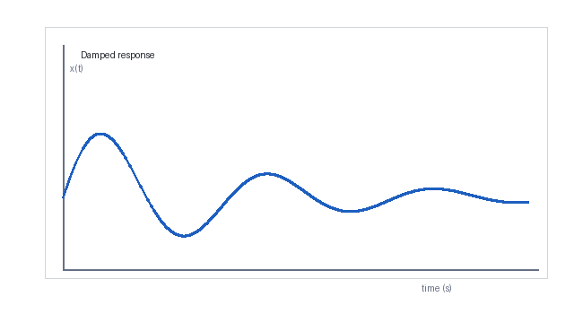

# PANO Markdown 渲染验证

这是一份用于 Phase 3.0 技术验证的 Markdown 样本，覆盖 **基础排版**、*强调*、~~删除线~~、`行内代码`、[链接](https://example.com) 与数学公式。

这是第一行，行尾两个空格带来硬换行。  
这是第二行。

## 1. 文本结构

### 嵌套列表

- 阅读与标注
  - 文本高亮、下划线与删除线
  - 区域截图与笔记
    - 支持 Markdown 与公式
- 数据安全
  1. 原始 PDF 只读
  2. 写入采用原子保存

> 引用：笔记应始终锚定到原始文档中的位置。

### 表格

| 方案 | 解析 | 数学渲染 | 许可 |
| --- | --- | --- | --- |
| MD4C | CommonMark + GFM | — | MIT |
| JKQTMathText | — | LaTeX 子集 | LGPL-2.1+ |
| 公式示例 | $E=mc^2$ | $\nabla\cdot\vec{E}=\rho/\varepsilon_0$ | — |

### 代码与转义

```cpp
const QString money = "$100";
const QString display = "$$x^2$$";
```

行内代码中的 `$x$` 与 `$$y$$` 不应被当作公式；转义美元符号为 \$100。

---

## 2. 行内公式

质能方程 $E=mc^2$，欧拉恒等式 $e^{i\pi}+1=0$，以及 $\alpha+\beta=\gamma$。

## 3. 显示公式

阻尼振动方程：

$$
m\ddot{u} + c\dot{u} + ku = 0
$$

积分与求和：

$$
\int_{0}^{1} x^{2}\,\mathrm{d}x = \frac{1}{3},
\qquad
\sum_{i=1}^{n} i^{2} = \frac{n(n+1)(2n+1)}{6}
$$

矩阵：

$$
\begin{bmatrix}
a & b \\
c & d
\end{bmatrix}
\begin{bmatrix}
x \\
y
\end{bmatrix}
= \begin{bmatrix}
ax+by \\
cx+dy
\end{bmatrix}
$$

分段函数：

$$
f(x)=
\begin{cases}
x^{2}, & x \ge 0, \\
-x, & x < 0.
\end{cases}
$$

多行对齐：

$$
\begin{aligned}
(a+b)^2 &= a^2 + 2ab + b^2, \\
(a-b)^2 &= a^2 - 2ab + b^2.
\end{aligned}
$$

括号与分式：

$$
\left( \frac{a}{b} \right)^{2} + \sqrt{x^{2}+y^{2}}
$$

## 4. 图片

本地图片（相对路径）：



## 5. 错误与边界

独立文件 `edge-cases.md` 包含缺失图片、未闭合公式、未知 TeX 和超长公式，便于验证失败是否可见、是否保留原始文本。
