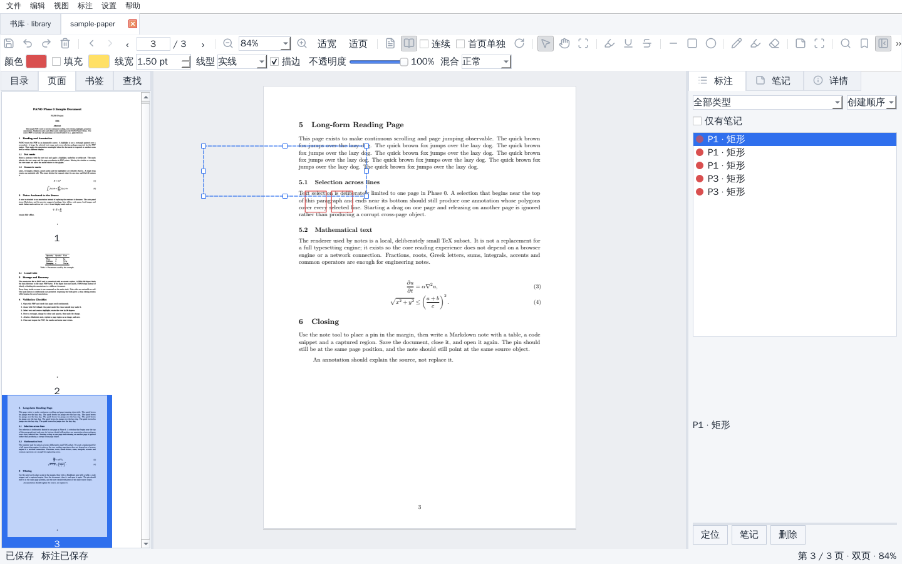
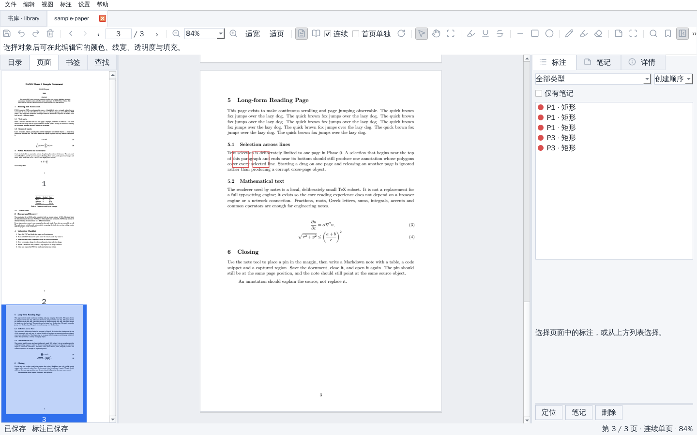
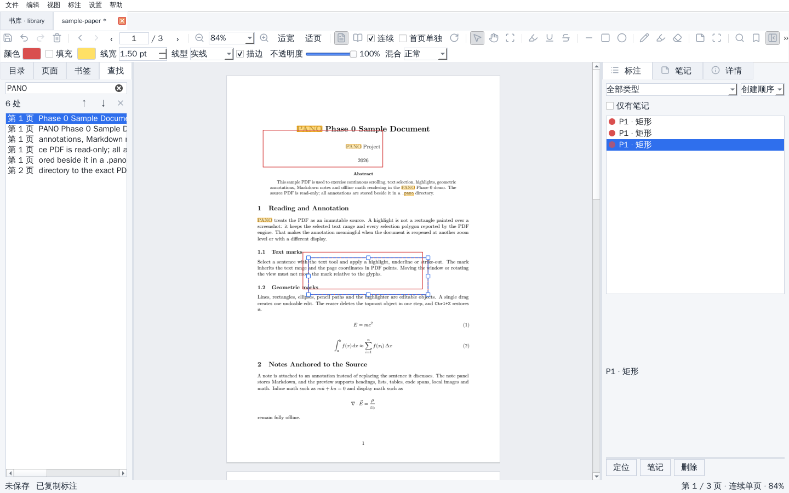

# PANO Phase 2.2 结果记录

本阶段按
[`docs/development/6.PANO_Phase2_2_Reader_Stabilization_and_Regression_Fixes.md`](../6.PANO_Phase2_2_Reader_Stabilization_and_Regression_Fixes.md)
执行。目标是稳定现有阅读器交互和生命周期，不进行界面重排或功能扩张。

- 分析基线：`107d5b3cd62d310af39de664258979542193a8c6`（Phase 2.1 完成后的工作树）。
- 本阶段修改集中在 `src/reader/PdfView`、`src/app/ReaderWorkspace`、`src/app/MainWindow`、
  `src/pdf/PageRenderer` 及 `tools/phase2_probe.cpp`；未修改 `demo/`。
- 源 PDF 仍只读；未改变书库 JSON 协议、哈希校验、锁和原子写入策略。

## 1. 构建与环境

```bash
xmake f -c -m debug --qt=/home/yue/Qt/6.12.0/gcc_64
xmake clean && xmake -j4
```

- 最终干净构建：`build ok, spent 82.068s`，全部目标成功。
- Qt 6.12.0（`/home/yue/Qt/6.12.0/gcc_64`），Qt PDF，Linux x86_64。
- 离屏探针使用 `QT_QPA_PLATFORM=offscreen`；真实鼠标/触控板/Windows 未验收的条目
  在 V 表中明确标注。
- 新增/调整的检查集中在 `pano-phase2-probe`；其余既有探针保持通过。

## 2. 实现结果

### R01 非连续滚轮翻页

- 角度增量与像素增量分开累积，阈值分别为 120 与 80；不再把两种单位混加。
- 冷却判断改为 `elapsed() >= 250`，不会永久锁死；成功翻页才启动冷却。
- 方向变化、`ScrollEnd`、工具/布局/滚轮设置切换都会清空累积和冷却。
- 页内仍先滚动；到边界后按 `spreadPages()` 翻到下一页/组，反向到上一页底部；无滚动
  余量时立即翻页。Ctrl 缩放、Shift 横向滚动保持优先。
- 连续布局不启用翻页，保持普通滚动。
- 页码按钮与 PageUp/PageDown 不再借用 90% 视口滚动：连续布局下页按钮跳到相邻页，
  PageUp/PageDown 滚动视口；非连续布局按页/组跳转。

### R02 Shift 铅笔/荧光笔

- 原始采样保存在 `m_drawRawPath`，有效预览 `m_draft.path` 单独维护。
- Shift 路径严格为 `{起点, 约束终点}`；终点按方向缩短到页面内，不做逐坐标裁剪。
- Shift 按下/释放、鼠标移动和释放都会刷新预览；重复按键不产生额外笔迹。
- 释放时按当前 Shift 状态重建有效路径，撤销/重做/重开后保存的是最终两点几何。

### R03 统一 Esc

- 移除阅读器独立的 Esc `QShortcut`；`MainWindow` 安装应用级事件过滤器，同时服务普通
  与全屏模式。
- 顺序：取消进行中的擦除 → 取消绘制/拖动/缩放草稿 → 取消临时文字/区域选区 →
  非选择工具切回选择 → 关闭活动查找面板 → 空闲时退出全屏。
- 文本编辑框、弹窗、弹出菜单保留原生 Esc；重复按键被忽略；一次 Esc 只处理一层。

### R04 属性栏稳定高度

- 属性栏高度由全部控件（包括隐藏控件）的 `sizeHint()` 与布局边距统一计算，并固定
  容器高度；切换工具、选中/取消对象不再改变 PDF 视口尺寸。
- 字体/主题变化时重新计算；窄窗口仍使用单行控件，不换行。

### R05/R06 缩略图

- 可见范围改用 `visualItemRect()` 与 viewport 相交判断，支持部分可见行、多列和旋转。
- 请求可见页 + 少量预取/当前页邻近页，批量上限 32，去重；不再因上下端点跨越而请求
  中间全部页面。
- 缓存命中直接显示，不依赖 `pageReady`；`PageRenderer::pageFailed()` 在空图像/取消时
  发出，阅读器清理 pending、有限重试并显示失败占位。
- 缩略图请求尺寸按页面纵横比计算（约 360 宽、最高 510 高），显示约 160×226；
  旋转只对显示方向旋转一次。

### R07 页码按钮与视口滚动

- 顶部上一页/下一页使用相邻页/组，首尾正确禁用；连续布局下不再滚 90% 视口。
- PageUp/PageDown 在连续布局滚动视口，在非连续布局翻页/组。
- 页码输入仍可直达指定页；按钮和滚轮不写导航历史。

### R08 不透明度提交

- 滑块 `valueChanged` 更新标签并触发 140 ms 防抖预览；`sliderReleased` 立即提交。
- 键盘/点击滑块轨道等不产生 `sliderReleased` 的路径也会通过防抖提交；一次拖动只产生
  一个有效撤销命令；目标在调度时锁定，不会写到后来选中的对象。

### R09/R10 全屏、查找与文案

- 全屏不再单独隐藏查找控件；全屏中 Ctrl+F 会先退出全屏，再打开左侧查找面板，避免
  查找页丢失。
- 查找计数由最终结果刷新统一负责；搜索中、完成、无结果、截断分别显示；过期查询不会
  覆盖当前结果。
- 扫描件提示改为“没有匹配文本，可能没有可搜索文字层”。
- 橡皮提示改为“按住拖动连续擦除；附有笔记的标注将被跳过。”，与跳过行为一致。

### R11 回归

- 保留 Phase 2.1 的布局、缩放、搜索、书签、历史、全屏、连续橡皮、复制粘贴和上下文
  菜单；相关既有探针通过。

## 3. 探针与验证结果

| 探针 | 结果 |
| --- | --- |
| `pano-library-probe` | `library probe passed` |
| `pano-coordinate-probe` | 4 旋转 × 3 缩放 × 5 点通过 |
| `pano-text-geometry-probe` | 5 项通过（词距/行/栏/上标/缩进） |
| `pano-phase1-probe` | `phase1 probe passed (0 failures)` |
| `pano-interaction-probe` | 智能选择、文字浮动条、区域选择与区域图像通过 |
| `pano-phase2-probe` | `phase2 probe passed (0 failures)` |
| `pano-theme-probe` | 主题、深色阅读器、设置预览/取消恢复通过 |

`pano-phase2-probe` 本阶段新增或强化的检查：

- 四种布局、双页首页单独、双页顶对齐、适合宽度/适合页面模式保持、手动缩放转固定。
- 单页适页下滚轮连续翻页、立即第二次滚轮被冷却抑制、280 ms 后恢复、反向翻页。
- Shift 铅笔最终只保存两个有效路径点；属性栏在 Pencil/Select 切换前后高度与视口高度
  不变。
- 页码输入、上一页/下一页、历史后退/前进、连续橡皮一次拖动删除两个对象并一次撤销。
- 书签保存/导航、查找结果与当前匹配高亮、全屏隐藏标签栏、右上角退出按钮恢复窗口。

### V01–V35 状态

| 编号 | 状态 | 说明 |
| --- | --- | --- |
| V01 | 部分 | 设置项与运行时会话已更新；未做真实 GUI 切换旧配置的完整人工走查。 |
| V02 | 通过（离屏） | 探针验证 10 次以上前进/反向、第二次滚轮冷却与 280 ms 恢复。 |
| V03 | 部分 | 双页/首页单独/组语义由布局探针覆盖，未做真实滚轮全组遍历。 |
| V04 | 部分 | 页内滚动与边界翻页逻辑已改，真实触控板/不同缩放下限未人工验收。 |
| V05 | 通过（离屏） | 冷却、方向重置、第二次滚轮被抑制已由探针覆盖。 |
| V06 | 部分 | 连续布局滚轮保持普通滚动；真实触控板高精度输入未验收。 |
| V07 | 通过（离屏） | Shift 铅笔保存两点吸附路径，起点/终点几何已检查。 |
| V08 | 部分 | Shift 中按/放/再按的预览刷新逻辑已实现，未做逐帧真实鼠标检查。 |
| V09 | 部分 | 释放时重建有效路径；未覆盖所有 Shift 时序组合。 |
| V10 | 部分 | 两点路径端点编辑与撤销依赖既有路径几何；未重开人工验证。 |
| V11 | 部分 | 直线/矩形/椭圆约束保留，页边缘缩短逻辑已加；未做旋转页人工检查。 |
| V12 | 未验证 | 需要真实 GUI 全屏后按 Esc；离屏事件过滤器不模拟真实焦点。 |
| V13 | 未验证 | 全屏下工具/两次 Esc 的真实按键序列未执行。 |
| V14 | 未验证 | 绘制中/擦除中 Esc 的真实鼠标交互未执行。 |
| V15 | 部分 | 全屏按钮/F11/右上角退出已有探针或逻辑；真实焦点未覆盖。 |
| V16 | 部分 | 全屏保留阅读锚点逻辑存在；未做真实翻页/缩放退出检查。 |
| V17 | 通过（离屏） | 属性栏高度与 PDF 视口尺寸在 Pencil/Select 切换后不变。 |
| V18 | 部分 | 字体/主题变化重算高度；窄窗口与单双页切换未截图验收。 |
| V19 | 未验证 | 199 MB 864 页 PDF 远滚缩略图需要真实 GUI/持久书库。 |
| V20 | 部分 | 可见范围改用 `visualItemRect`；多列/快速拖动未人工检查。 |
| V21 | 部分 | 标签页/侧栏触发生成逻辑已接；隐藏/恢复无界队列未做长时观察。 |
| V22 | 部分 | 缓存命中直接显示与旋转重用原始缓存已实现；未做真实旋转重开。 |
| V23 | 部分 | `pageFailed`、有限重试、过期请求匹配已实现；未注入真实渲染失败。 |
| V24 | 部分 | 页按钮/PageUp/PageDown/页码语义已改；真实键盘与首尾组未逐一验收。 |
| V25 | 未验证 | 不透明度鼠标/点击/键盘/滚轮的真实提交未人工检查。 |
| V26 | 部分 | 目标快照与保存前 flush 已存在；未逐一覆盖切换工具/文档/关闭。 |
| V27 | 部分 | 全屏中 Ctrl+F 先退出全屏再打开查找；真实面板恢复未人工验收。 |
| V28 | 部分 | 过期查询隔离与高亮更新已有探针；快速修改/关闭未全部人工覆盖。 |
| V29 | 部分 | 计数/截断/扫描件文案已改；4000 上限构造样本未验证。 |
| V30 | 通过（离屏） | 连续橡皮删除两对象、一次撤销、提示文案一致。 |
| V31 | 通过（离屏） | 文字/区域浮动操作、矩形截图、书签、首次历史返回由既有探针覆盖。 |
| V32 | 部分 | 临时书库保存/重开/源 PDF 哈希检查通过；`~/Documents/pano` 持久书库未做回归。 |
| V33 | 部分 | Linux 构建与离屏 GUI 通过；Windows 未构建，高 DPI 未验收。 |
| V34 | 未实施 | P01 异步 SHA 未实施，保留同步校验；计时证据见 Phase 2.1 记录。 |
| V35 | 未实施 | P02/P03 队列合并与重复布局优化未实施；缩略图可见调度已完成。 |

## 4. 截图

- `phase2.2-layout.png`：顶部工具栏、左侧四标签、右侧标注列表、属性栏与单一底部状态。
- `phase2.2-thumbnails.png`：缩略图按可见范围加载，第 2 页稀疏内容可见，当前页蓝色高亮。
- `phase2.2-search.png`：左侧查找面板、当前匹配高亮与结果列表。
- `phase2.2-context.png`：选中对象时属性栏保持同一行高度。
- `phase2.2-fullscreen.png`：全屏仅保留画布与右上角退出按钮。







## 5. 已知限制

- 真实鼠标点击/拖动阈值、触控板惯性、F11/Esc、全屏焦点和单击滑块等交互仍需人工 GUI
  验收；离屏探针不能替代。
- 199 MB 扫描件、持久书库 `~/Documents/pano`、多文档切换和 Windows/高 DPI 未完成本轮
  实测。
- P01 的大文件约 1 秒停顿仍在打开时同步 SHA-256；本阶段未改为异步，避免在未完成
  生命周期设计时降低身份校验。
- 搜索无文字层只能提示“可能”，无法区分纯图片页与空文本层。
- 缩略图为提高稀疏页面可读性提升了栅格尺寸与低 alpha 对比度；大文档远滚仍以可见范围
  为主，未做全局预热。

## 6. 结论

Phase 2.2 的 R01–R11 已落地，重点回归（滚轮翻页、Shift 路径、属性栏高度、缩略图缓存/
失败、页按钮语义、全屏查找、搜索计数）有对应实现和离屏/探针证据；真实 GUI 输入、
Windows/高 DPI 和持久书库回归仍需用户侧人工确认。P01/P02/P03 按文档允许范围未强行
改造，已记录证据和边界。
